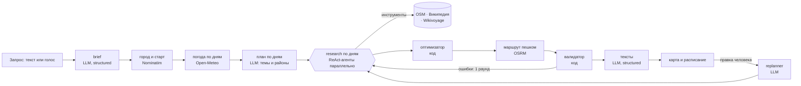

# Прогулка

LLM-агент, который планирует **путешествие в незнакомый город**: пеший маршрут на каждый
день поездки **из реальных мест** под интересы конкретного человека. Местный и так знает,
куда пойти; путешественник тратит час-два на подготовку каждого дня — карты, блоги, часы
работы, «успею ли дойти». Здесь достаточно сказать голосом или написать как другу: «Пять
дней в Петербурге с 24 октября, люблю конструктивизм, хороший кофе и виды на воду, музеи
не надо, живём у Московского вокзала» — даты выбираются в календаре, время слайдером.
Через минуту на одной карте готовы маршруты всех дней: у каждой остановки время, переход
пешком, «почему это вам» и ссылка на источник; места между днями не повторяются. Любой
день можно поправить словами («во вторник дождь», «убери второй собор»).

Прогулка знает своего путешественника: после регистрации — короткая анкета (интересы,
темп, сколько готов пройти, с детьми ли, еда), для каждой поездки — панель «больше
природы / меньше баров», а агент сам запоминает устойчивые предпочтения из запросов и
правок («не любит музеи») и учитывает их в следующих поездках. Все путешествия хранятся
в кабинете, к любому можно вернуться и продолжить.

**Живая версия: <https://progulka.gornin.com>** — можно войти демо-аккаунтом
(`demo@progulka.app` / `progulka-demo`, указан и на странице входа) или зарегистрироваться.

Проект курса LLM Agents (НИУ ВШЭ, лектор А. Алгазинов). Презентация proposal —
[`docs/proposal.pdf`](docs/proposal.pdf).

## Команда

| Участник | GitHub |
|---|---|
| Роман Бекетов | [@rbeketov](https://github.com/rbeketov) |
| Ярослав Кузьмин | [@yarikTri](https://github.com/yarikTri) |
| Даниил Горнин | [@dgornin](https://github.com/dgornin) |
| Иван Прыгунов | [@juzu400](https://github.com/juzu400) |

## Проблема и почему здесь нужна LLM

В незнакомом городе подготовка каждого дня поездки — час-два ручной работы: карты,
Википедия, блоги, проверка часов работы, прикидка, что успеешь пешком, и как не ходить
по одним и тем же местам в разные дни. Пять дней — полдня подготовки. Готовые подборки
«топ-10» не знают твоих интересов, а местный совет есть не у всех.

Спросить ChatGPT быстро, но маршрут получается правдоподобным, а не проверенным. Модель
смешивает реальные и несуществующие места, ставит музей на час, когда он закрыт, и
закладывает на переход 10 минут там, где идти час. Наш eval это измеряет (ниже).

Мы делим работу так:

| Что | Кто делает | Почему |
|---|---|---|
| Понять свободный запрос: город, время, интересы с весами, что исключить | LLM, structured output | Это язык, правилами не разобрать |
| Решить, где искать каждый интерес, и отобрать подходящие места по их описаниям | LLM-агент с инструментами | Путь поиска зависит от найденного: «конструктивизм» — поиск по Википедии, «стрит-арт» — объекты OSM, «уличная еда» — OSM и Wikivoyage |
| Найти реальные места, часы работы, описания, погоду | Код: OpenStreetMap, Википедия, Wikivoyage, Open-Meteo | Факты берутся из источников, а не из памяти модели |
| Выбрать, что успеть, и в каком порядке | Детерминированный оптимизатор | Это задача ориентирования с временными окнами; арифметику времени LLM делает ненадёжно |
| Проверить маршрут: открыто ли, укладывается ли во время | Детерминированный валидатор | Внешний критик, а не «модель, проверь себя» |
| Написать описания остановок и понять правку пользователя | LLM, structured output | Язык; тексты строятся только из данных источников |

## Какая LLM и зачем

Провайдер — [OpenRouter](https://openrouter.ai) через OpenAI-совместимый API; модель
задаётся в `.env` (`MODEL_NAME`), код от провайдера не зависит.

По умолчанию — **`anthropic/claude-haiku-5.5`**. Модель работает в шести местах:

1. `app/agent/brief.py` — разбор запроса в `TripBrief` (structured output по JSON Schema),
   включая диапазон дат («5 дней», «с 24 по 28 октября»); если текста нет, а город и даты
   заданы формой, бриф собирается кодом без LLM.
2. `app/agent/outline.py` — план поездки по дням: тема, акцент на интересах и район
   каждого дня (только для путешествий от двух дней).
3. `app/agent/researcher.py` — агентный цикл: вызывает инструменты поиска и отбирает места.
4. `app/agent/writer.py` — тексты остановок, только из данных источников.
5. `app/agent/replanner.py` — правка пользователя → структурированное изменение дня.
6. `app/agent/memory.py` — извлекает из запроса или правки до трёх устойчивых фактов
   о путешественнике для долговременной памяти.

Голосовой ввод распознаёт отдельная аудио-модель — **`qwen/qwen3.8-omni-flash`**
(`STT_MODEL`, `app/agent/speech.py`): из трёх аудио-моделей OpenRouter только она
распознала тестовую русскую фразу целиком; ~5 с и ~$0.0001 на фразу. Звук пишется в
браузере и отправляется на сервер, поэтому ввод работает в любом браузере, а не только
там, где есть Web Speech API.

Почему эта модель — мы сравнили четыре модели на одном пайплайне и одних запросах
(`eval/results/`):

| Модель | Вызовов LLM | Время, с | Цена маршрута, $ | Остановок | Закрыто / невозможных переходов |
|---|---|---|---|---|---|
| `anthropic/claude-haiku-5.5` | 8.0 | 38 | 0.0113 | 9.3 | 0 / 0 |
| `deepseek/deepseek-v4.1-flash` | 10.0 | 57 | 0.0113 | 12.0 | 0 / 0 |
| `openai/gpt-6-luna` | 16.0 | 58 | 0.0036 | 8.7 | 0 / 0 |
| `nvidia/nemotron-3-super-120b-a12b:free` | 14.7 | 63 | 0.0000 | 4.7 | 0 / 0 |

Средние по трём одинаковым запросам (Петербург, Казань, Париж), полный пайплайн.

Haiku делает меньше всего шагов и отвечает быстрее всех — для живого сценария, где человек
ждёт маршрут, это главное; маршрут стоит около цента. DeepSeek за ту же цену находит больше
остановок, но в полтора раза медленнее — запасной вариант. GPT-6 luna втрое дешевле, но
делает вдвое больше шагов. Бесплатная модель не справилась с циклом вызова инструментов:
в двух запросах из трёх она истратила весь лимит шагов и нашла по два места.

## Как это работает



Для многодневной поездки это **Plan-and-Execute**: план пишет LLM (`app/agent/outline.py`)
— у каждого дня тема, акцент на интересах и район, районы проверяет геокодер (выдуманный или
слишком далёкий район заменяется точкой старта); исполнители — ReAct-агенты поиска по одному
на день, они работают параллельно (не больше четырёх) и делят общий реестр найденных мест;
перепланирование — правка конкретного дня. Затем код собирает дни **по очереди и без
повторов**: место, взятое в день 1, не попадёт в день 2; правка дня не берёт места других дней.

Внутри дня это **workflow**: фиксированная цепочка шагов (LLM-шаги со structured output и
детерминированные шаги), их порядок записан в коде (`app/pipeline.py`). Агент — **только шаг
research**: там следующий шаг зависит от найденного, и это единственное место, где гибкость
агента окупается. Однодневная прогулка — путешествие из одного дня, план для неё не нужен.

### Анатомия агента

| Часть | Где | Как |
|---|---|---|
| Модель | `app/llm.py` | Тонкая обёртка над OpenAI-совместимым API: ретраи на 429/5xx, учёт токенов и стоимости, проверка JSON с повторным запросом при ошибке валидации, кэш ответов |
| Инструменты | `app/agent/tools.py` | 7 инструментов с JSON-схемами (их видно на `GET /api/tools`): `search_osm`, `search_wikipedia`, `get_wikivoyage_listings`, `get_place_details`, `shortlist_place`, `remove_place`, `finish_research`. Категории OSM — enum: модель не пишет Overpass QL |
| Цикл | `app/agent/researcher.py` | Свой ReAct-цикл: вызов → `tool_calls` → параллельное выполнение → `role=tool` с `tool_call_id` → снова вызов |
| Рабочая память | `ResearchState` в `app/agent/tools.py` | Реестр всех найденных мест, шорт-лист, отвергнутые места; сохраняется вместе с поездкой в БД, поэтому правки продолжают работу агента даже после перезапуска сервера |
| Долговременная память | `app/agent/memory.py`, `app/personalization.py` | Анкета (явные предпочтения) и факты, которые агент выучил из запросов и правок. В бриф анкета вливается кодом с явным приоритетом «форма > текст запроса > анкета > умолчания»; факты попадают в контекст агента и писателя как данные. Факты пишутся без подтверждения, но видны и удаляются в профиле: обратимость вместо одобрения |
| Терминация | `app/agent/researcher.py` | `finish_research` принят (шорт-лист достаточен, у сильных интересов есть кандидаты); лимит шагов (14); лимит времени (150 с); повтор одного и того же вызова; два ответа подряд без инструментов; ошибка провайдера. Причина остановки логируется и показывается в интерфейсе |

### Решения, которые стоит объяснить

- **Свой цикл, а не LangChain/LangGraph.** Цикл — около ста строк, и в нём нам важен
  полный контроль над бюджетом, терминацией и тем, что попадает в контекст; состояние
  поездки и так хранится в базе, а правка дня возвращается в пайплайн. Решение build vs
  adopt хотим принять по измерению: к финалу соберём тот же пайплайн дня на LangGraph
  и сравним на запросах eval.
- **Оркестратор и субагенты, а не «команда» ролевых агентов.** Поездка на несколько дней
  делится на независимые подзадачи: планировщик раскладывает её по дням, а на каждый
  день запускается свой агент-исследователь с чистым контекстом; агенты работают
  параллельно, делят общий реестр мест и возвращают только шорт-лист. Решает,
  кого запускать, код, а не LLM. Внутри дня задача не делится — там один агент.
- **Grounding.** `shortlist_place` принимает только `id`, который вернул инструмент;
  выдуманное место в маршрут попасть не может. Тексты пишутся только из данных источников.
- **Внешний критик.** Валидатор проверяет часы работы, окно времени, длину маршрута,
  исключённые категории и покрытие интересов. При ошибке агент получает его выводы как цель
  и делает один ограниченный раунд исправления.
- **Персонализация — код, а не промпт.** Слияние анкеты, панели поездки и запроса —
  детерминированная функция с тестами (`app/personalization.py`): понятно, почему в маршруте
  «природа», и легко проверить, что «меньше баров» сильнее любви к барам из анкеты.
- **Память: что, когда и как читать.** Пишем только устойчивые предпочтения (не город и
  не дату этой поездки), не больше трёх за раз, без дублей и с потолком 50 на человека;
  агенту показываем 20 последних. Ошибка или таймаут извлечения не ломают маршрут.
- **Аккаунты без лишних зависимостей.** Пароли — `scrypt` из стандартной библиотеки, сессия —
  случайный токен в HttpOnly-cookie (в БД хранится только его хэш), ограничение попыток входа.
- **Человек в цикле.** Агент только читает открытые данные, необратимых действий нет,
  поэтому подтверждения не нужны; человек управляет результатом правками
  («после 15 дождь» помечает эти часы дождливыми для оптимизатора).
- **Недоверенные данные.** Тексты из OSM/Википедии/Wikivoyage — данные, а не инструкции;
  промпт это фиксирует, а инструменты ничего не могут изменить вне сессии.
- **Оптимизатор.** Жадная вставка по «ценности на добавленную минуту» + 2-opt, с учётом
  часов работы, дождя, обеда для длинных прогулок и убывающей ценности одного интереса.
  Детерминирован: одинаковый вход — одинаковый маршрут.
- **Скорость источников.** Запрос к Overpass по bbox вместо `around:` (секунды вместо
  таймаутов), переключение между публичными серверами, дисковый кэш HTTP-ответов.

## Запуск в Docker

Нужны Docker и ключ [OpenRouter](https://openrouter.ai/keys).

```bash
cp .env.example .env    # затем впишите свой ключ в API_KEY
docker compose up --build
```

Откройте <http://localhost:8000>. Остановить — `docker compose down`. Порт открыт только
на `127.0.0.1`: каждый запрос тратит ключ API. Кэш `.cache` смонтирован в контейнер,
поэтому прогон, отрепетированный локально с `LLM_REPLAY=1`, воспроизводится и в Docker.

Переменные `.env` (полный список — в `.env.example`):

| Переменная | Значение |
|---|---|
| `API_KEY` | ключ OpenRouter |
| `BASE_URL` | `https://openrouter.ai/api/v1` (подойдёт любой OpenAI-совместимый endpoint) |
| `MODEL_NAME` | модель; в `.env.example` — `anthropic/claude-haiku-5.5` |
| `LLM_TEMPERATURE`, `LLM_REASONING` | параметры генерации (по умолчанию 0.2 и `off`) |
| `AGENT_MAX_STEPS` | лимит шагов агента (14) |
| `OVERPASS_URLS` | публичные серверы Overpass через запятую, в порядке попыток |
| `HTTP_USER_AGENT` | представляемся OSM и Wikimedia, как требуют их правила |
| `LLM_REPLAY` | `1` — ответы LLM записываются в `.cache/llm`, и такой же запрос потом отвечается из записи (страховка демо); `0` — на диск ничего не пишется. Голосовые записи не сохраняются никогда |
| `TODAY` | зафиксировать «сегодня» (`YYYY-MM-DD`): дата входит в промпт, так что прогон, отрепетированный накануне, воспроизводится из кэша только с той же датой |
| `STT_MODEL` | аудио-модель для голосового ввода, по умолчанию `qwen/qwen3.8-omni-flash` |
| `DATA_DIR` | где лежит база SQLite с аккаунтами и поездками (по умолчанию `.data`; в Docker — `./data` рядом с compose-файлом) |
| `DEMO_EMAIL`, `DEMO_PASSWORD` | демо-аккаунт: создаётся при старте и показывается на странице входа |
| `ADMIN_EMAIL`, `ADMIN_PASSWORD` | администратор: создаётся при старте, нигде не показывается; смена пароля в `.env` выкидывает старые сессии |
| `COOKIE_SECURE` | `1` — cookie сессии только по HTTPS (включено в `docker-compose.prod.yml`) |
| `CACHE_DIR` | где лежат кэши HTTP и LLM (по умолчанию `.cache` в репозитории; в Docker он же смонтирован в `/srv/cache`) |

## Деплой на сервер

На сервере нужны Docker и открытые порты 80 и 443.

```bash
git clone https://github.com/dgornin/progulka && cd progulka
cp .env.example .env    # ключ API, и обязательно лимиты: RATE_LIMIT_PER_HOUR, DAILY_BUDGET_USD, MAX_CONCURRENT_RUNS
docker compose -f docker-compose.prod.yml up -d --build
```

Обновление: `git pull && docker compose -f docker-compose.prod.yml up -d --build`.

`docker-compose.prod.yml` публикует наружу только [Caddy](https://caddyserver.com) (`deploy/Caddyfile`):
он сам получает HTTPS-сертификат для `SITE_ADDRESS` и проксирует запросы в приложение,
не буферизуя поток событий агента. Сейчас это `progulka.gornin.com` и запасной
`185-156-108-126.sslip.io` (sslip.io превращает IP в имя, для которого можно выпустить
сертификат; адреса в `SITE_ADDRESS` перечисляются через запятую); свой домен —
A-запись на IP сервера и `SITE_ADDRESS` в `.env`.

Аккаунты и поездки хранятся в `./data/progulka.db` — эту папку и стоит бэкапить.

Ссылку может открыть кто угодно, а каждый маршрут тратит ключ API, поэтому на сервере
включены лимиты (`app/limits.py`): запусков в час с одного адреса, трат на LLM в сутки
и одновременных прогонов. Отказ приходит до запуска агента и ничего не стоит.

## Локальный запуск и тесты

```bash
python3.12 -m venv .venv
.venv/bin/pip install -r requirements-dev.txt
.venv/bin/uvicorn app.main:app --reload     # http://localhost:8000, Swagger: /docs
.venv/bin/pytest -q                          # офлайн: без ключа и без сети
.venv/bin/ruff check app tests eval
```

CI (`.github/workflows/ci.yml`) на каждый push гоняет линтер, тесты и собирает
Docker-образ с проверкой `/api/health`.

## API

Авторизация — HttpOnly-cookie `progulka_session`; ошибки — `{"detail": "..."}` по-русски.

- `POST /api/auth/register`, `POST /api/auth/login`, `POST /api/auth/logout`, `GET /api/me`
  (с флагом `is_demo`: интерфейс не предлагает общему демо-аккаунту то, что сервер запретит).
- `GET|PUT /api/profile` — анкета; `GET /api/memory`, `DELETE /api/memory/{id}` — факты памяти.
- `GET /api/catalog` — каталог интересов и темпов для анкеты и панели поездки.
- `POST /api/plan` — `{request?, city?, date_from?, date_to?, start_time?, end_time?,
  start_point?, preferences: {more, less, pace, with_kids, max_walk_km}}` → поток NDJSON: по
  событию на строку (план дней, этапы и вызовы инструментов с номером дня, кандидаты, факты
  памяти, итоговое путешествие с `journey_id` и маршрутами всех дней). До 7 дней.
- `GET /api/journeys`, `GET|DELETE /api/journeys/{id}`,
  `POST /api/journeys/{id}/days/{index}/feedback` `{feedback, exclude_place_ids?}` → такой же
  поток, правит один день сохранённого путешествия.
- `POST /api/transcribe` `{audio: base64 WAV 16 кГц моно, до 60 с}` → `{text}` — голосовой ввод.
- `GET /api/admin/stats|users|trips` — для администратора.
- `GET /api/tools` — JSON-схемы инструментов ровно в том виде, в каком их получает модель;
  `GET /api/config` (демо-аккаунт для страницы входа), `GET /api/health`.

## Оценка: агент против той же модели с одним промптом

`eval/run_eval.py` строит маршрут двумя способами **одной и той же моделью** и проверяет
оба одним кодом: агент (весь пайплайн) и baseline — один промпт без инструментов
«составь пеший маршрут, верни JSON». Места baseline ищутся в OpenStreetMap мягко
(по названию, по очищенному названию, по адресу), чтобы сравнение не подыгрывало агенту.

| | Агент | Один промпт, та же модель |
|---|---|---|
| Реальные места: из источников / нашлись в OSM | 77/77 | 48/68 |
| Закрыто в момент визита | 0 | 4 |
| Невозможные переходы (времени меньше, чем идти) | 0 | 25 (в 7 из 8 маршрутов) |
| Пешком в среднем, км | 5.3 | 19.0 |
| Вызовов LLM / цена / время в среднем | 7 / $0.010 / 32 с | 1 / $0.0004 / 27 с |

8 запросов по 7 городам, модель `anthropic/claude-haiku-5.5`. Baseline дешевле и быстрее, но его маршрут чаще всего нельзя пройти: время между остановками меньше, чем занимает дорога.

Полные таблицы — `eval/results/`. Запуск: `python -m eval.run_eval [--model ...] [--only id,id]`.

## Структура репозитория

```
app/
  main.py          HTTP: страницы, API, потоковая выдача событий агента
  auth.py          пароли (scrypt), сессии в cookie, роли
  db.py            SQLite (SQLAlchemy): пользователи, сессии, поездки, память
  store.py         сохранение поездок с состоянием агента, профиль, память, статистика
  limits.py        лимиты публичного деплоя: запуски в час, бюджет в сутки, параллельность;
                   скользящее окно для попыток входа и регистраций (используется в main.py)
  profile.py       каталог интересов, анкета (Profile), настройки поездки
  personalization.py  слияние формы, запроса и анкеты в бриф (код, не LLM);
                   факты памяти — в контекст агента и писателя
  pipeline.py      фиксированный пайплайн и раунд исправления
  config.py        настройки из окружения
  models.py        доменные модели: TripBrief, Place, Candidate, Plan, ...
  llm.py           обёртка над OpenAI-совместимым API
  agent/           всё, где работает LLM
    prompts.py       системные промпты
    brief.py         запрос → TripBrief
    tools.py         инструменты агента и их JSON-схемы, ResearchState
    researcher.py    ReAct-цикл и условия остановки
    writer.py        тексты остановок
    outline.py       план путешествия по дням: темы, акценты, районы (Plan-and-Execute)
    replanner.py     правка пользователя → PlanEdit
    memory.py        извлечение фактов для долговременной памяти
    speech.py        распознавание голоса аудио-моделью
  planning/        детерминированная часть
    geo.py           расстояния, скорость ходьбы, лимит длины дневного маршрута
    hours.py         часы работы (синтаксис opening_hours из OSM)
    optimizer.py     выбор и порядок остановок
    routing.py       пешеходный маршрут OSRM
    validator.py     проверка плана
  sources/         открытые данные
    http.py          общий HTTP-клиент: User-Agent, лимиты, кэш, ретраи
    geocode.py       Nominatim
    osm.py           Overpass: места по каталогу категорий
    wikipedia.py     поиск по координатам и по теме
    wikivoyage.py    листинги путеводителя
    weather.py       Open-Meteo
  static/          интерфейс без сборки: лендинг, вход, кабинет, анкета/профиль,
                   планировщик путешествий (MapLibre GL + OpenFreeMap, календарь,
                   слайдер времени, запись голоса), админка
tests/             офлайн-тесты с записанными ответами API, в том числе на prompt injection
eval/              сравнение с baseline и между моделями, многодневные поездки
docs/proposal.pdf  презентация proposal
AGENTS.md          правила для coding-агентов: команды, соглашения, definition of done
deploy/Caddyfile   HTTPS-прокси для деплоя (docker-compose.prod.yml)
```

## Ограничения и план к финальной защите

Сейчас: города с хорошим покрытием OSM и Википедии; маршрут дня — в пределах суток;
поездка до 7 дней в одном городе; демо-аккаунт общий для всех посетителей: его поездки
видят все, кто в него вошёл, поэтому профиль у него только для чтения, памяти о посетителях
он не ведёт, а при перезапуске поездки демо-аккаунта стираются.

Уже сделано: многодневные путешествия (Plan-and-Execute: планировщик дней и параллельные
агенты-исследователи по дням с общим реестром мест), голосовой ввод, календарь и слайдер
времени, аккаунты и кабинет, анкета и настройки поездки, долговременная память
о путешественнике, деплой по ссылке.

К финалу:
- **тот же пайплайн дня на LangGraph** — граф с общим состоянием, условными переходами
  и чекпоинтами — и сравнение с нашим циклом на запросах eval: объём кода, время, цена,
  поведение при ошибках инструментов и при правке дня;
- **eval персонализации и памяти**: попадание в интересы и соблюдение «не надо»,
  LLM-as-judge, откалиброванный на ручной разметке, и расширение eval до десятков запросов;
- **RAG по путеводителям** (Wikivoyage и статьи Википедии целиком) для поиска мест
  «по смыслу», с метриками retrieval;
- **трассировка и оценка траекторий**: шаги и причины остановки агентов, стоимость
  по пользователям.

Чего мы сознательно не делаем: бронирование и оплату (необратимые действия); ролевых
агентов, которые спорят в общем чате, — субагенты появляются только там, где задача
действительно делится (по дням); LLM-критика поверх детерминированного валидатора, пока
eval не покажет выигрыш; генерацию маршрута «из головы» модели.
