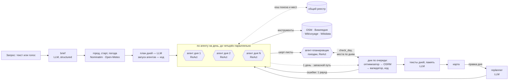

# Прогулка

LLM-агент, который планирует **путешествие в незнакомый город**: пеший маршрут на каждый
день поездки **из реальных мест** под интересы конкретного человека. Местный и так знает,
куда пойти; путешественник собирает это сам — карты, блоги, отзывы, часы работы, «успею
ли дойти». В опросе Go City × Talker Research (2 000 путешественников из США, 2024) поиск
впечатлений и экскурсий — самая долгая часть подготовки поездки: 3 ч 54 мин. Здесь достаточно сказать голосом или написать как другу: «Пять
дней в Петербурге с 24 октября, люблю конструктивизм, хороший кофе и виды на воду, музеи
не надо, живём у Московского вокзала» — даты выбираются в календаре, время слайдером.
Через одну-две минуты на одной карте готовы маршруты всех дней (замер eval: прогулка
на один день — около 30 с и меньше цента, 3 дня — 55–96 с и 3–5 центов, 5 дней — 83 с
и 5 центов; на живом сервере время зависит от загрузки источников и провайдера): у каждой
остановки время, переход пешком, «почему это вам», ссылка на источник и на это место
в Яндекс Картах и Google Maps (для отзывов, фото и «как пройти»); места между днями не
повторяются. Любой день можно поправить словами («во вторник дождь», «убери второй собор»).

Прогулка знает своего путешественника: после регистрации — короткая анкета (интересы,
темп, сколько готов пройти, с детьми ли, еда), для каждой поездки — панель «больше
природы / меньше баров», а агент сам запоминает устойчивые предпочтения из запросов и
правок («не любит музеи») и учитывает их в следующих поездках. Все путешествия хранятся
в кабинете, к любому можно вернуться и продолжить.

**Живая версия: <https://progulka.gornin.com>** — можно войти демо-аккаунтом
(`demo@progulka.app` / `progulka-demo`, указан и на странице входа) или зарегистрироваться.

Проект курса LLM Agents (НИУ ВШЭ, лектор А. Алгазинов). Презентация proposal —
[`docs/proposal.pdf`](docs/proposal.pdf).

## Команда

| Участник | GitHub |
|---|---|
| Роман Бекетов | [@rbeketov](https://github.com/rbeketov) |
| Ярослав Кузьмин | [@yarikTri](https://github.com/yarikTri) |
| Даниил Горнин | [@dgornin](https://github.com/dgornin) |
| Иван Прыгунов | [@juzu400](https://github.com/juzu400) |

## Проблема и почему здесь нужна LLM

В незнакомом городе понять, куда сходить, — самая долгая часть подготовки поездки
(3 ч 54 мин из 17 ч 42 мин в опросе Go City × Talker Research, США, 2024): карты,
Википедия, блоги, отзывы, проверка часов работы, прикидка, что успеешь пешком, и как не
ходить по одним и тем же местам в разные дни. Готовые подборки «топ-10» не знают твоих
интересов, а местный совет есть не у всех.

Спросить ChatGPT быстро, но маршрут получается правдоподобным, а не проверенным. Модель
смешивает реальные и несуществующие места, ставит музей на час, когда он закрыт, и
закладывает на переход 10 минут там, где идти час. Наш eval это измеряет (ниже).

Мы делим работу так:

| Что | Кто делает | Почему |
|---|---|---|
| Понять свободный запрос: город, время, интересы с весами, что исключить | LLM, structured output | Это язык, правилами не разобрать |
| Решить, где искать каждый интерес, и отобрать подходящие места по их описаниям | LLM-агент с инструментами | Путь поиска зависит от найденного: «конструктивизм» — поиск по Википедии, «стрит-арт» — объекты OSM, «уличная еда» — OSM и Wikivoyage |
| Раздать найденное по дням поездки | LLM-агент-планировщик; каждый день он проверяет кодом | Какому дню отдать место, зависит от найденного: два агента дней нашли один собор, дождливому дню нужны музеи, найденные другим днём |
| Найти реальные места, часы работы, описания, погоду, насколько место известно | Код: OpenStreetMap, Википедия, Wikivoyage, Open-Meteo; популярность — Wikidata и просмотры Википедии | Факты берутся из источников, а не из памяти модели |
| Выбрать, что успеть, и в каком порядке | Детерминированный оптимизатор | Это задача ориентирования с временными окнами; арифметику времени LLM делает ненадёжно |
| Проверить маршрут: открыто ли, укладывается ли во время | Детерминированный валидатор | Внешний критик, а не «модель, проверь себя» |
| Написать описания остановок и понять правку пользователя | LLM, structured output | Язык; тексты строятся только из данных источников |

## Какая LLM и зачем

Провайдер — [OpenRouter](https://openrouter.ai) через OpenAI-совместимый API; модель
задаётся в `.env` (`MODEL_NAME`), код от провайдера не зависит.

По умолчанию — **`anthropic/claude-haiku-5.5`**. Модель работает в семи местах:

1. `app/agent/brief.py` — разбор запроса в `TripBrief` (structured output по JSON Schema),
   включая диапазон дат («5 дней», «с 24 по 28 октября»); если текста нет, а город и даты
   заданы формой, бриф собирается кодом без LLM.
2. `app/agent/outline.py` — план поездки по дням: тема, акцент на интересах, район и
   названные путешественником места каждого дня (только для путешествий от двух дней).
3. `app/agent/researcher.py` — агентный цикл: вызывает инструменты поиска и отбирает места.
4. `app/agent/planner.py` — агент-планировщик поездки: раздаёт находки агентов дней по
   дням и проверяет каждый день кодом (только для путешествий от двух дней).
5. `app/agent/writer.py` — тексты остановок, только из данных источников.
6. `app/agent/replanner.py` — правка пользователя → структурированное изменение дня.
7. `app/agent/memory.py` — извлекает из запроса или правки до трёх устойчивых фактов
   о путешественнике для долговременной памяти.

Голосовой ввод распознаёт отдельная аудио-модель — **`qwen/qwen3.8-omni-flash`**
(`STT_MODEL`, `app/agent/speech.py`): из трёх аудио-моделей OpenRouter только она
распознала тестовую русскую фразу целиком; ~5 с и ~$0.0001 на фразу. Звук пишется в
браузере и отправляется на сервер, поэтому ввод работает в любом браузере, а не только
там, где есть Web Speech API.

Почему эта модель — мы сравнили четыре модели на одном пайплайне и одних запросах
(`eval/results/`):

| Модель | Вызовов LLM | Время, с | Цена маршрута, $ | Остановок | Закрыто / невозможных переходов |
|---|---|---|---|---|---|
| `anthropic/claude-haiku-5.5` | 5.7 | 29 | 0.0079 | 10.3 | 0 / 0 |
| `openai/gpt-6-luna` | 16.0 | 49 | 0.0034 | 8.0 | 0 / 0 |
| `deepseek/deepseek-v4.1-flash` | 7.3 | 78 | 0.0123 | 10.0 | 0 / 0 |
| `nvidia/nemotron-3-super-120b-a12b:free` | 14.7 | 63 | 0.0000 | 4.7 | 0 / 0 |

Средние по трём одинаковым запросам (Петербург, Казань, Париж), полный пайплайн. Haiku —
из основного прогона eval (коммит `c620619`, уже с сигналом популярности), GPT-6 luna и
DeepSeek — на `fdacd35`, до него; бесплатную модель 20 октября провайдер не обслуживал (все три запроса — ошибка
провайдера), поэтому её строка из прогона 19 октября. Три запроса — ориентир, а не
статистика: к финалу сравнение будет на всём наборе eval.

Haiku делает меньше всего шагов и отвечает быстрее всех — для живого сценария, где человек
ждёт маршрут, это главное; день поездки стоит около цента. GPT-6 luna вдвое с лишним
дешевле, но делает почти втрое больше вызовов. DeepSeek находит столько же мест, но в полтора раза
дороже и почти втрое медленнее — запасной вариант. Бесплатная модель не справилась
с циклом вызова инструментов: в двух запросах из трёх она истратила весь лимит шагов
и нашла по два места.

## Как это работает



Многодневная поездка — **оркестратор, исполнители и синтезатор** (orchestrator-workers)
в форме Plan-and-Execute:

- **оркестратор: план дней — LLM, запуск — код.** План пишет LLM (`app/agent/outline.py`):
  у каждого дня тема, акцент на интересах, район и места, которые путешественник назвал;
  районы проверяет геокодер (выдуманный или слишком далёкий район заменяется точкой
  старта). Агентов запускает код, по одному на день: их число задают даты, а не модель;
- **исполнители** — ReAct-агенты поиска, по одному на день, до четырёх параллельно, каждый
  в чистом контексте. Во время поиска они не видят шорт-листов друг друга: общий реестр —
  кэш запросов к источникам и найденных мест, а не канал между агентами;
- **синтезатор** — агент-планировщик поездки (`app/agent/planner.py`). Он получает
  шорт-листы всех дней сразу (fan-in, одна запись на реальное место) и раздаёт места по
  дням инструментами `assign_day`, `check_day`, `finish_plan`. `check_day` прогоняет на
  местах дня настоящие оптимизатор, OSRM и валидатор, ничего не фиксируя: критик — код, а не
  сама модель. Место достаётся только одному дню — здесь решается, кому из агентов, нашедших
  одно и то же, оно отойдёт;
- затем код строит каждый день из его распределения, считая места остальных дней занятыми
  (по реальному месту, а не по `id`), так что повтор невозможен, что бы ни сделал агент. Если
  планировщик не закончил или его план не собирается, дни, как и раньше, собирает код
  (поездка строится, в интерфейсе — предупреждение); `TRIP_PLANNER_AGENT=0` выключает
  планировщика совсем;
- перепланирование — правка конкретного дня (`app/agent/replanner.py`); планировщика она
  не зовёт: остальные дни сохраняют свои места, а места других дней правка не берёт.

Внутри дня это **workflow**: фиксированная цепочка шагов (LLM-шаги со structured output и
детерминированные шаги), их порядок записан в коде (`app/pipeline.py`). Агенты стоят только
там, где следующий шаг зависит от найденного: **поиск** (какой источник, какой запрос) и
**раздача находок по дням**. Всё, что можно посчитать, — код. Однодневная прогулка —
путешествие из одного дня: плана дней и планировщика у неё нет.

### Анатомия агента

| Часть | Где | Как |
|---|---|---|
| Модель | `app/llm.py` | Тонкая обёртка над OpenAI-совместимым API: ретраи на 429/5xx, учёт токенов и стоимости, кэш ответов. Structured output — `response_format` с JSON Schema и `strict: False`: правильность ответа гарантирует не провайдер, а наша проверка pydantic, одинаковая для любой модели; при ошибке модель получает её текст и отвечает заново (до двух повторов) |
| Инструменты | `app/agent/tools.py` | 7 инструментов с JSON-схемами (их видно на `GET /api/tools`): `search_osm`, `search_wikipedia`, `get_wikivoyage_listings`, `get_place_details`, `shortlist_place`, `remove_place`, `finish_research`. Категории OSM — enum: модель не пишет Overpass QL. В выдаче поиска известные места (`pop` ≥ 0.5) в пределах 2 км идут первыми, дальше — по расстоянию |
| Инструменты планировщика поездки | `app/agent/planner.py` | 3 инструмента: `assign_day` — места дня, только `id` из пула находок; место, которое уже у другого дня, не принимается (в ответе — какой день его держит); `check_day` — оптимизатор → OSRM → валидатор на местах дня без фиксации: остановки со временем, что выпало и почему, нарушения, подходящие свободные места рядом; `finish_plan` — принимается, когда каждый день проверен после последнего изменения и проверка не нашла, что исправлять |
| Цикл | `app/agent/researcher.py`, `app/agent/planner.py` | Свой ReAct-цикл: вызов → `tool_calls` → выполнение (у агента дня — параллельно, у планировщика — по порядку) → `role=tool` с `tool_call_id` → снова вызов |
| Рабочая память | `ResearchState` в `app/agent/tools.py` | Реестр всех найденных мест, шорт-лист, отвергнутые места; сохраняется вместе с поездкой в БД, поэтому правки продолжают работу агента даже после перезапуска сервера |
| Долговременная память | `app/agent/memory.py`, `app/personalization.py` | Анкета (явные предпочтения) и факты, которые агент выучил из запросов и правок. В бриф анкета вливается кодом с явным приоритетом «форма > текст запроса > анкета > умолчания»; факты попадают в контекст агента и писателя как данные. Факты пишутся без подтверждения, но видны и удаляются в профиле: обратимость вместо одобрения |
| Терминация | `app/agent/researcher.py`, `app/agent/planner.py` | Агент дня: `finish_research` принят (шорт-лист достаточен, у сильных интересов есть кандидаты); лимит шагов (14); лимит времени (150 с); повтор одного и того же вызова; два ответа подряд без инструментов; ошибка провайдера. Планировщик: `finish_plan` принят; 12 шагов; 90 с; повтор одного вызова на неизменном плане; два ответа подряд без инструментов; ошибка провайдера. Его план берётся, только если он закончил или остановился на плане, где каждый день проверен кодом без ошибок; иначе дни собирает код, с предупреждением. Причина остановки логируется и показывается в интерфейсе |

### Решения, которые стоит объяснить

- **Свой цикл, а не LangChain/LangGraph.** Цикл — около ста строк, и в нём нам важен
  полный контроль над бюджетом, терминацией и тем, что попадает в контекст; состояние
  поездки и так хранится в базе, а правка дня возвращается в пайплайн. Решение build vs
  adopt хотим принять по измерению: к финалу соберём тот же пайплайн дня на LangGraph
  и сравним на запросах eval.
- **Оркестратор, исполнители и синтезатор, а не «команда» ролевых агентов.** Поиск по
  дням — независимые подзадачи: LLM раскладывает поездку по дням (тема, район, названные
  места), а код запускает на каждый день своего агента-исследователя с чистым контекстом —
  сколько агентов, задают даты, роутер — код, а не LLM. Агенты работают параллельно и
  возвращают только шорт-лист; находок друг друга во время поиска они не видят, общий
  реестр — лишь кэш поиска и мест. Конфликты (два агента нашли одно место, одному дню мест
  не хватает) решает агент-планировщик поездки: он видит все шорт-листы сразу, отдаёт
  каждое место одному дню и проверяет дни кодом. До планировщика конфликт решал код —
  выигрывал более ранний день; эта сборка осталась запасным путём. Внутри дня задача не
  делится — там один агент. Что агент на день лучше одного агента на всю поездку, мы ещё не
  измеряли — это первый пункт плана к финалу.
- **Популярность — подсказка, а не цель.** Насколько место известно, считает код
  (`app/sources/wikidata.py`): число языковых версий статьи в Wikidata и просмотры статьи
  в Википедии за 60 дней (ru + en), в одной абсолютной шкале 0–1 — Эрмитаж 0.91, Кул-Шариф
  0.79, Дом-коммуна инженеров и писателей в Петербурге 0.44. Агент видит `pop` и выбирает «что нельзя пропустить
  в первый раз», но решает соответствие запросу, а «не туристическое» означает обратное.
  Источники CC0, без ключа и доступны из России. TripAdvisor, Google Places, Яндекс
  Геопоиск и Foursquare мы не берём: их условия запрещают отдавать данные LLM, хранить их
  или показывать на чужой карте. Сбой Wikimedia не ломает поиск: места просто без `pop`.
- **Grounding.** `shortlist_place` принимает только `id`, который вернул инструмент, а
  `assign_day` — только `id` из шорт-листов; выдуманное место в маршрут попасть не может.
  Тексты пишутся только из данных источников.
- **Внешний критик.** Валидатор проверяет часы работы, окно времени, длину маршрута,
  исключённые категории и покрытие интересов. При ошибке агент получает его выводы как цель
  и делает один ограниченный раунд исправления. Тот же код через `check_day` слушает
  агент-планировщик поездки.
- **Персонализация — код, а не промпт.** Слияние анкеты, панели поездки и запроса —
  детерминированная функция с тестами (`app/personalization.py`): понятно, почему в маршруте
  «природа», и легко проверить, что «меньше баров» сильнее любви к барам из анкеты.
- **Память: что, когда и как читать.** Пишем только устойчивые предпочтения (не город и
  не дату этой поездки), не больше трёх за раз, без дублей и с потолком 50 на человека;
  агенту показываем 20 последних. Ошибка или таймаут извлечения не ломают маршрут.
- **Аккаунты без лишних зависимостей.** Пароли — `scrypt` из стандартной библиотеки, сессия —
  случайный токен в HttpOnly-cookie (в БД хранится только его хэш), ограничение попыток входа.
- **Человек в цикле.** Агент только читает открытые данные, необратимых действий нет,
  поэтому подтверждения не нужны; человек управляет результатом правками
  («после 15 дождь» помечает эти часы дождливыми для оптимизатора).
- **Недоверенные данные.** Тексты из OSM/Википедии/Wikivoyage — данные, а не инструкции;
  промпт это фиксирует, а инструменты ничего не могут изменить вне сессии.
- **Оптимизатор.** Жадная вставка по «ценности на добавленную минуту» + 2-opt, с учётом
  часов работы, дождя, обеда для длинных прогулок и убывающей ценности одного интереса.
  Детерминирован: одинаковый вход — одинаковый маршрут.
- **Скорость источников.** Запрос к Overpass по bbox вместо `around:` (секунды вместо
  таймаутов), переключение между публичными серверами, дисковый кэш HTTP-ответов.

## Запуск в Docker

Нужны Docker и ключ [OpenRouter](https://openrouter.ai/keys).

```bash
cp .env.example .env    # затем впишите свой ключ в API_KEY
docker compose up --build
```

Откройте <http://localhost:8000>. Остановить — `docker compose down`. Порт открыт только
на `127.0.0.1`: каждый запрос тратит ключ API. Кэш `.cache` смонтирован в контейнер,
поэтому прогон, отрепетированный локально с `LLM_REPLAY=1`, воспроизводится и в Docker.

Переменные `.env` (полный список — в `.env.example`):

| Переменная | Значение |
|---|---|
| `API_KEY` | ключ OpenRouter |
| `BASE_URL` | `https://openrouter.ai/api/v1` (подойдёт любой OpenAI-совместимый endpoint) |
| `MODEL_NAME` | модель; в `.env.example` — `anthropic/claude-haiku-5.5` |
| `LLM_TEMPERATURE`, `LLM_REASONING` | параметры генерации (по умолчанию 0.2 и `off`) |
| `AGENT_MAX_STEPS` | лимит шагов агента дня (14) |
| `TRIP_PLANNER_AGENT` | `1` (по умолчанию) — в поездке от двух дней найденное раздаёт по дням агент-планировщик; `0` — дни собирает код (абляция eval; то же происходит, когда планировщик не закончил) |
| `OVERPASS_URLS` | публичные серверы Overpass через запятую, в порядке попыток |
| `HTTP_USER_AGENT` | представляемся OSM и Wikimedia, как требуют их правила |
| `LLM_REPLAY` | `1` — ответы LLM записываются в `.cache/llm`, и такой же запрос потом отвечается из записи (страховка демо); `0` — на диск ничего не пишется. Голосовые записи не сохраняются никогда |
| `TODAY` | зафиксировать «сегодня» (`YYYY-MM-DD`): дата входит в промпт, так что прогон, отрепетированный накануне, воспроизводится из кэша только с той же датой |
| `STT_MODEL` | аудио-модель для голосового ввода, по умолчанию `qwen/qwen3.8-omni-flash` |
| `DATA_DIR` | где лежит база SQLite с аккаунтами и поездками (по умолчанию `.data`; в Docker — `./data` рядом с compose-файлом) |
| `DEMO_EMAIL`, `DEMO_PASSWORD` | демо-аккаунт: создаётся при старте и показывается на странице входа |
| `ADMIN_EMAIL`, `ADMIN_PASSWORD` | администратор: создаётся при старте, нигде не показывается; смена пароля в `.env` выкидывает старые сессии |
| `COOKIE_SECURE` | `1` — cookie сессии только по HTTPS (включено в `docker-compose.prod.yml`) |
| `CACHE_DIR` | где лежат кэши HTTP и LLM (по умолчанию `.cache` в репозитории; в Docker он же смонтирован в `/srv/cache`) |
| `DATABASE_URL` | своя база вместо SQLite в `DATA_DIR` (любой URL SQLAlchemy с асинхронным драйвером) |
| `RATE_LIMIT_PER_HOUR`, `DAILY_BUDGET_USD`, `MAX_CONCURRENT_RUNS` | защита публичного деплоя (`app/limits.py`): запусков в час с одного адреса, дневной бюджет LLM в долларах, одновременных запусков; `0` — без ограничения |
| `SITE_ADDRESS` | только для `docker-compose.prod.yml`: домены, на которые Caddy получает HTTPS-сертификат |

## Деплой на сервер

На сервере нужны Docker и открытые порты 80 и 443.

```bash
git clone https://github.com/dgornin/progulka && cd progulka
cp .env.example .env    # ключ API, и обязательно лимиты: RATE_LIMIT_PER_HOUR, DAILY_BUDGET_USD, MAX_CONCURRENT_RUNS
docker compose -f docker-compose.prod.yml up -d --build
```

Обновление: `git pull && docker compose -f docker-compose.prod.yml up -d --build`.

`docker-compose.prod.yml` публикует наружу только [Caddy](https://caddyserver.com) (`deploy/Caddyfile`):
он сам получает HTTPS-сертификат для `SITE_ADDRESS` и проксирует запросы в приложение,
не буферизуя поток событий агента. Сейчас это `progulka.gornin.com` и запасной
`185-156-108-126.sslip.io` (sslip.io превращает IP в имя, для которого можно выпустить
сертификат; адреса в `SITE_ADDRESS` перечисляются через запятую); свой домен —
A-запись на IP сервера и `SITE_ADDRESS` в `.env`.

Аккаунты и поездки хранятся в `./data/progulka.db` — эту папку и стоит бэкапить.

Ссылку может открыть кто угодно, а каждый маршрут тратит ключ API, поэтому на сервере
включены лимиты (`app/limits.py`): запусков в час с одного адреса, трат на LLM в сутки
и одновременных прогонов. Отказ приходит до запуска агента и ничего не стоит.

## Локальный запуск и тесты

```bash
python3.12 -m venv .venv
.venv/bin/pip install -r requirements-dev.txt
.venv/bin/uvicorn app.main:app --reload     # http://localhost:8000, Swagger: /docs
.venv/bin/pytest -q                          # офлайн: без ключа и без сети
.venv/bin/ruff check app tests eval
```

CI (`.github/workflows/ci.yml`) на каждый push гоняет линтер, тесты и собирает
Docker-образ с проверкой `/api/health`.

## API

Авторизация — HttpOnly-cookie `progulka_session`; ошибки — `{"detail": "..."}` по-русски.

- `POST /api/auth/register`, `POST /api/auth/login`, `POST /api/auth/logout`, `GET /api/me`
  (с флагом `is_demo`: интерфейс не предлагает общему демо-аккаунту то, что сервер запретит).
- `GET|PUT /api/profile` — анкета; `GET /api/memory`, `DELETE /api/memory/{id}` — факты памяти.
- `GET /api/catalog` — каталог интересов и темпов для анкеты и панели поездки.
- `POST /api/plan` — `{request?, city?, date_from?, date_to?, start_time?, end_time?,
  start_point?, preferences: {more, less, pace, with_kids, max_walk_km}}` → поток NDJSON: по
  событию на строку (план дней, этапы и вызовы инструментов с номером дня, кандидаты, факты
  памяти, итоговое путешествие с `journey_id` и маршрутами всех дней). До 7 дней.
- `GET /api/journeys`, `GET|DELETE /api/journeys/{id}`,
  `POST /api/journeys/{id}/days/{index}/feedback` `{feedback, exclude_place_ids?}` → такой же
  поток, правит один день сохранённого путешествия.
- `POST /api/transcribe` `{audio: base64 WAV 16 кГц моно, до 60 с}` → `{text}` — голосовой ввод.
- `GET /api/admin/stats|users|trips` — для администратора.
- `GET /api/tools` — JSON-схемы инструментов ровно в том виде, в каком их получает модель;
  `GET /api/config` (демо-аккаунт для страницы входа), `GET /api/health`.

## Оценка: агент против той же модели с одним промптом

`eval/run_eval.py` строит маршрут двумя способами **одной и той же моделью** и проверяет
оба одним кодом: агент (весь пайплайн) и baseline — один промпт без инструментов
«составь пеший маршрут, верни JSON». Места baseline ищутся в OpenStreetMap мягко
(по названию, по очищенному названию, по адресу), чтобы сравнение не подыгрывало агенту.

| | Агент | Один промпт, та же модель |
|---|---|---|
| Реальные места: из источников / нашлись в OSM | 79/79 (по построению) | 55/68 |
| Закрыто в момент визита | 0 | 1 |
| Невозможные переходы (времени меньше, чем идти) | 0 | 26 (во всех 8 маршрутах) |
| Места из «не надо» (музеи, церкви) | 0 | 0 |
| Интересы, для которых есть остановка (по меткам интересов, которые ставит агент) | 27/27 | не измеряем (нет разметки остановок) |
| Известность мест: средний `pop` / доля «must-see» (`pop` ≥ 0.7) | 0.53 / 8% | 0.63 / 10% |
| Пешком в среднем, км | 5.2 | 14.3 |
| Вызовов LLM / цена / время в среднем | 6 / $0.008 / 32 с | 1 / $0.0004 / 24 с |

8 однодневных запросов по 7 городам, модель `anthropic/claude-haiku-5.5`, коммит `c620619`.
Baseline дешевле и быстрее, но его маршрут нельзя пройти: время между остановками меньше,
чем занимает дорога, и в среднем 14 км за день. Нули и 100% агента в первых строках — по
построению, а не заслуга модели: реальность мест держит grounding (`shortlist_place`
принимает только `id` из выдачи инструментов), проходимость — код (оптимизатор и валидатор);
в этом и смысл разделения «LLM — язык, код — факты и время». Вклад LLM видно в других
строках: «не надо» соблюдается, потому что модель правильно разобрала запрос, а интересы
покрыты, потому что агент нашёл места под каждый (это метки самого агента; проверка по смыслу
— LLM-as-judge к финалу).

Строка про известность — честный минус и вопрос к финалу: один промпт называет
открыточные места со всего города (средний `pop` 0.63), агент — места рядом и под интересы
(0.53; «конструктивизм в Петербурге» — 0.47 против 0.65). Чтобы понять, что из этого лучше
для путешественника, нужна оценка соответствия интересам по смыслу — LLM-as-judge к финалу.

### Против чата с веб-поиском

Один промпт без инструментов — слабый соперник: на деле маршрут спрашивают у чата
с поиском в интернете, как ChatGPT или Claude с браузингом. Харнесс (`--harness`) даёт
модели тот же промпт, сегодняшнюю дату и веб-поиск OpenRouter: сколько и что искать, решает
сама модель (до 5 поисков по 5 результатов). Те же 8 прогулок, тот же код проверки;
Sonnet из-за бюджета — только на 5 из них.

| | Агент | Один промпт | Чат + веб-поиск, Haiku 5.5 | Чат + веб-поиск, Sonnet 5.5 (5 прогулок) |
|---|---|---|---|---|
| Реальные места | 100% (79/79, по построению) | 81% (55/68) | 60% (42/70) | 69% (29/42) |
| Закрыто в момент визита | 0 | 1 | 2 | 3 |
| Невозможные переходы (маршрутов с ними) | 0 (0/8) | 26 (8/8) | 20 (8/8) | 9 (4/5) |
| Пешком в среднем, км | 5.2 | 14.3 | 12.2 | 11.9 |
| Известность мест, средний `pop` | 0.53 | 0.63 | 0.58 | 0.61 |
| Токенов на маршрут | ≈65 тыс. (оценка по цене: в этом прогоне не записывали) | — | ≈45 тыс. | ≈74 тыс. |
| Цена / время на маршрут | $0.0084 / 32 с | $0.0004 / 24 с | $0.044 / 12 с | $0.258 / 64 с |

Агент и один промпт — прогон `c620619`, чат — 20 октября, код харнесса в `7a5a8c2`. На тех же
5 прогулках, что Sonnet, у агента 51/51 место, 0 невозможных переходов, `pop` 0.54 и $0.0087.

Веб-поиск не делает маршрут проходимым и часы верными: невозможные переходы есть во всех
маршрутах чата с Haiku и в 4 из 5 у Sonnet, закрытые места тоже есть. Агент в 5 раз дешевле
той же модели с поиском и примерно в 30 раз дешевле Sonnet с поиском — не за счёт токенов
(у агента их, по оценке, даже больше, чем у чата с той же моделью), а потому что его
источники бесплатны, а поиск платный. Чат с той же
моделью быстрее (12 с против 32 с; у агента это весь пайплайн, у чата — только ответ) и
называет места известнее (`pop` 0.58–0.61 против 0.53) — честный минус, как и у одного
промпта. Оговорка: чат отвечает прозой, и в тот же JSON для проверки её переводит наша
модель; часть потерь в строке «реальные места» может быть ошибкой этого перевода.

### Многодневные поездки

Только агент: baseline и чат по построению планируют одну прогулку. Коммит `7a5a8c2`,
с агентом-планировщиком:

| Запрос | Дней | Остановок по дням | Закрыто / невозможных | Повторов между днями | «Не надо» | Интересы | Вызовов LLM | Цена | Время |
|---|---|---|---|---|---|---|---|---|---|
| Казань, 3 дня | 3/3 | 11, 10, 3 | 0 / 0 | 0 | 0 | 5/5 | 31 | $0.051 | 96 с |
| Петербург, 5 дней | 5/5 | 11, 8, 9, 11, 10 | 0 / 0 | 0 | 0 | 3/3 | 33 | $0.052 | 83 с |
| Москва, 4 дня | 4/4 | 12, 13, 10, 11 | 0 / 0 | 0 | 0 | 5/5 | 28 | $0.044 | 71 с |
| Париж, 3 дня | 3/3 | 8, 15, 12 | 0 / 0 | 0 | 0 | 4/4 | 22 | $0.032 | 55 с |

Дни исследуются параллельно (до четырёх сразу), поэтому время растёт медленнее числа дней.

### Синтезатор: с ним и без

Те же 4 поездки, та же модель и коммит; без синтезатора — `TRIP_PLANNER_AGENT=0`: дни
собирает код, каждый берёт сначала свои находки, затем остатки других дней
(`eval/results/*-noplanner.*`). Суммы и средние по четырём поездкам:

| | С агентом-планировщиком | Сборка кодом |
|---|---|---|
| Самый короткий день к самому длинному, по остановкам, в среднем | 0.58 | 0.47 |
| Невозможные переходы, всего | 0 | 1 |
| Повторов между днями / закрыто в момент визита | 0 / 0 | 0 / 0 |
| Остановок, всего | 154 | 170 |
| Известность в среднем: `pop` / доля «must-see» | 0.50 / 8% | 0.52 / 9% |
| Вызовов LLM на поездку | 28.5 | 22.5 |
| Цена / время на поездку | $0.045 / 76 с | $0.033 / 58 с |

Синтезатор выравнивает дни (короткий день — 58% от длинного против 47%) и убрал единственный
невозможный переход; стоит примерно на треть дороже и на ~20 с дольше; на известность мест
не влияет. Сборка кодом жадная: первые дни забирают всё, что нашли (Казань — 15, 14, 5
остановок). Синтезатор пока не спасает каждый день: в Казани третий день, понедельник,
вышел из трёх остановок, а сборка заняла 96 с — главный кандидат на доработку. Четыре
поездки — ориентир, а не статистика: к финалу — больше поездок и LLM-as-judge.

Полные таблицы, коммит и дата каждого прогона — `eval/results/`. Запуск:
`python -m eval.run_eval [--model ...] [--only id,id]` (вызывает провайдера и тратит ключ);
чат с веб-поиском — `--harness MODEL`, абляция — тот же запуск с `TRIP_PLANNER_AGENT=0`.

## Структура репозитория

```
app/
  main.py          HTTP: страницы, API, потоковая выдача событий агента
  auth.py          пароли (scrypt), сессии в cookie, роли
  db.py            SQLite (SQLAlchemy): пользователи, сессии, поездки, память
  store.py         сохранение поездок с состоянием агента, профиль, память, статистика
  limits.py        лимиты публичного деплоя: запуски в час, бюджет в сутки, параллельность;
                   скользящее окно для попыток входа и регистраций (используется в main.py)
  profile.py       каталог интересов, анкета (Profile), настройки поездки
  personalization.py  слияние формы, запроса и анкеты в бриф (код, не LLM);
                   факты памяти — в контекст агента и писателя
  pipeline.py      оркестрация поездки, фиксированный пайплайн дня, раунд исправления,
                   сборка дней кодом, когда планировщика нет
  config.py        настройки из окружения
  models.py        доменные модели: TripBrief, Place, Candidate, Plan, ...
  llm.py           обёртка над OpenAI-совместимым API
  agent/           всё, где работает LLM
    prompts.py       системные промпты
    brief.py         запрос → TripBrief
    tools.py         инструменты агента и их JSON-схемы, ResearchState
    researcher.py    ReAct-цикл агента дня и условия остановки
    planner.py       агент-планировщик поездки (синтезатор): раздаёт находки по дням
    writer.py        тексты остановок
    outline.py       план путешествия по дням: темы, акценты, районы (Plan-and-Execute)
    replanner.py     правка пользователя → PlanEdit
    memory.py        извлечение фактов для долговременной памяти
    speech.py        распознавание голоса аудио-моделью
  planning/        детерминированная часть
    geo.py           расстояния, скорость ходьбы, лимит длины дневного маршрута
    hours.py         часы работы (синтаксис opening_hours из OSM)
    optimizer.py     выбор и порядок остановок
    routing.py       пешеходный маршрут OSRM
    validator.py     проверка плана
  sources/         открытые данные
    http.py          общий HTTP-клиент: User-Agent, лимиты, кэш, ретраи
    geocode.py       Nominatim
    osm.py           Overpass: места по каталогу категорий
    wikipedia.py     поиск по координатам и по теме
    wikivoyage.py    листинги путеводителя
    wikidata.py      популярность: языковые версии и просмотры статей Википедии
    weather.py       Open-Meteo
  static/          интерфейс без сборки: лендинг, вход, кабинет, анкета/профиль,
                   планировщик путешествий (MapLibre GL + OpenFreeMap, календарь,
                   слайдер времени, запись голоса), админка
tests/             офлайн-тесты с записанными ответами API, в том числе на prompt injection
eval/              сравнение с baseline, с чатом с веб-поиском и между моделями,
                   многодневные поездки с планировщиком и без
docs/proposal.pdf  презентация proposal
AGENTS.md          правила для coding-агентов: команды, соглашения, definition of done
deploy/Caddyfile   HTTPS-прокси для деплоя (docker-compose.prod.yml)
```

## Ограничения и план к финальной защите

Сейчас: города с хорошим покрытием OSM и Википедии; маршрут дня — в пределах суток;
поездка до 7 дней в одном городе; демо-аккаунт общий для всех посетителей: его поездки
видят все, кто в него вошёл, поэтому профиль у него только для чтения, памяти о посетителях
он не ведёт, а при перезапуске поездки демо-аккаунта стираются. Стоимость прогона
ограничивают лимиты шагов и времени каждого агента и дневной бюджет, который проверяется до
запуска; отдельного потолка в долларах на один прогон и prompt caching пока нет.

Уже сделано: многодневные путешествия (план дней от LLM, параллельные агенты-исследователи
по дням с общим кэшем поиска, агент-планировщик поездки как синтезатор), голосовой ввод,
календарь и слайдер времени, аккаунты и кабинет, анкета и настройки поездки, долговременная
память о путешественнике, деплой по ссылке.

К финалу:
- **абляция «один агент на всю поездку против агента на день»** — что деление по дням
  действительно окупается — и доработка синтезатора: ровнее дни (без дня из трёх остановок)
  и быстрее сборка, на большем числе поездок;
- **тот же пайплайн дня на LangGraph** — граф с общим состоянием, условными переходами
  и чекпоинтами — и сравнение с нашим циклом на запросах eval: объём кода, время, цена,
  поведение при ошибках инструментов и при правке дня;
- **eval персонализации и памяти**: попадание в интересы и соблюдение «не надо»,
  LLM-as-judge, откалиброванный на ручной разметке, и расширение eval до десятков запросов;
- **RAG по путеводителям** (Wikivoyage и статьи Википедии целиком) для поиска мест
  «по смыслу», с метриками retrieval;
- **трассировка и оценка траекторий**: шаги и причины остановки агентов, стоимость
  по пользователям.

Чего мы сознательно не делаем: бронирование и оплату (необратимые действия); ролевых
агентов, которые спорят в общем чате, — субагенты появляются только там, где задача
действительно делится (по дням), а их находки сводит один синтезатор; LLM-критика поверх
детерминированного валидатора, пока eval не покажет выигрыш; генерацию маршрута «из головы»
модели.
